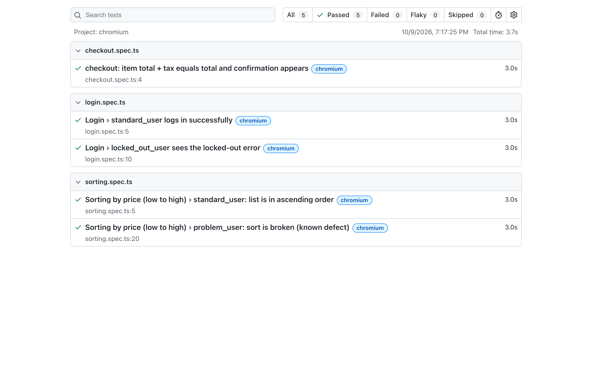

# Sauce Demo - Playwright tests

A small Playwright suite in TypeScript covering login, checkout and sorting on saucedemo.com.
I used page objects plus a couple of custom fixtures. Locators go through `getByTestId`, which is
mapped to the site's `data-test` attributes in the config, and there are no hard waits.

## Setup
```bash
npm install
npx playwright install chromium
cp .env.example .env     # optional, the defaults are the public demo credentials
```

## Running
```bash
npm test                 # runs headless and generates the HTML report
npm run report           # opens the report
npm run test:headed
npm run typecheck
```

## Layout
- `tests/` - login, checkout and sorting specs
- `pages/` - page objects for login, inventory and checkout
- `fixtures/` - config (users, test data, expected messages) and the extended `test` with page fixtures

Credentials and the base URL come from `.env`. Everything else the tests need is in `fixtures/config.ts`,
so the specs themselves don't contain any hardcoded data.

## Report
HTML report from a local run (Chromium):



## Bonus: sorting as problem_user
For `problem_user`, choosing "Price (low to high)" doesn't do anything. The products stay in the default
order ($29.99, $9.99, $15.99, $49.99, $7.99, $15.99) and the dropdown jumps back to "Name (A to Z)".
No error is shown, so a user could easily assume the list had been sorted.

I kept the same ascending-order check for this user and marked the test with `test.fail()`. Playwright
reports it as an expected failure, so the run stays green while the bug is there. If the bug is fixed,
the test starts failing, which tells us to remove the annotation.

## Promo Codes: what I'd automate first
I'd start with the pricing and validation cases (PC-01 to 04, PC-17, PC-19) at the API level, with unit
tests around the discount calculation. That's where a bug costs real money, and those checks are
deterministic, quick and stable below the UI. Next would be lockout and revalidation when the cart or
expiry changes (PC-22, 25, 27, 28), also at the API level, since that has to be enforced on the server.
That needs a way to control the clock. For the UI, I'd keep a small smoke set per platform (PC-12, 13,
26, 30) because UI tests across three clients get slow and flaky quickly. Keyboard, rotation,
backgrounding and accessibility checks (PC-35, 37) I'd leave manual for now.
